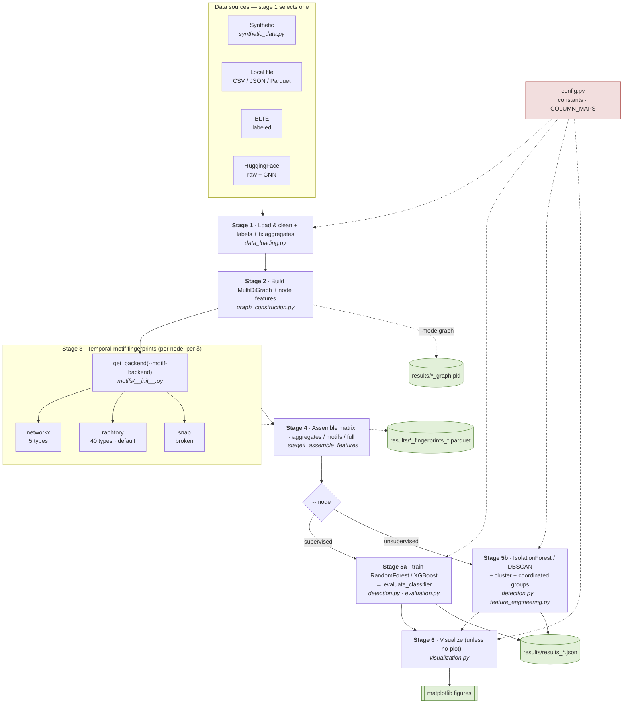
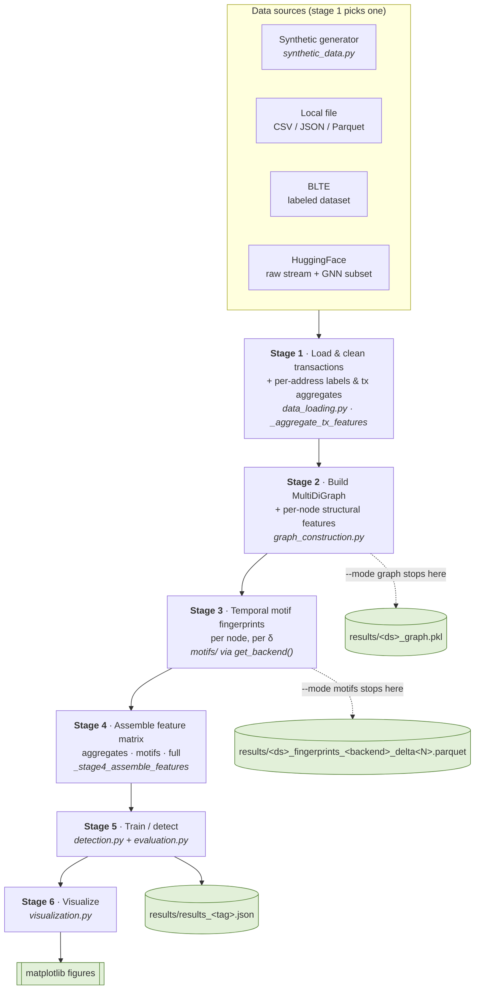
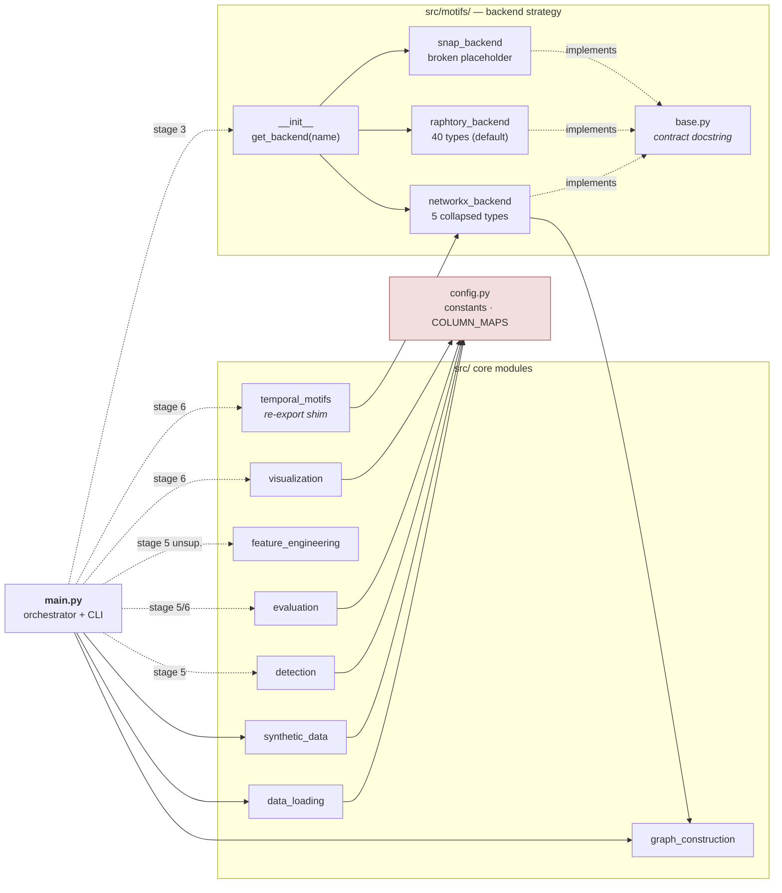
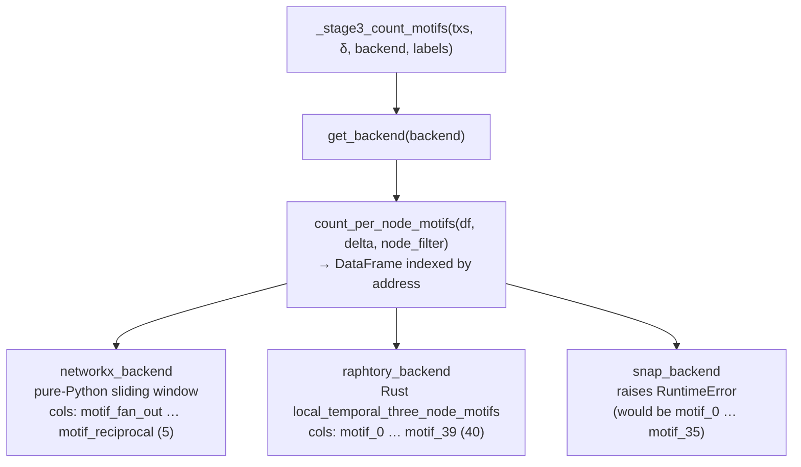
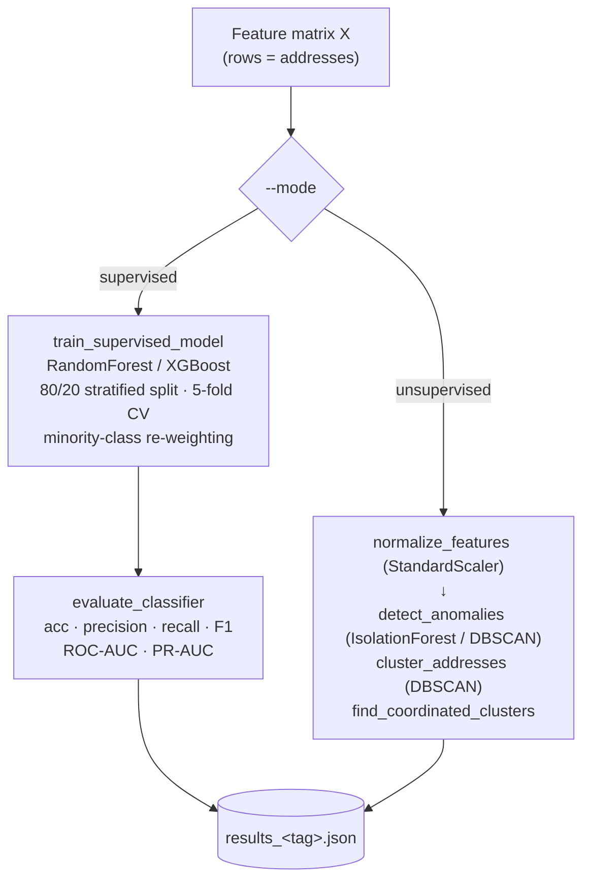

# Architecture

This document describes the runtime architecture of the temporal-motif coordinated-behaviour
detection pipeline. Diagrams are written in [Mermaid](https://mermaid.js.org/) and render
directly on GitHub.

For *what* each flag/mode does, see [`README.md`](README.md). This document covers *how the
code is wired together*.

Rendered copies of every diagram (SVG / PNG / PDF) live in [`diagrams/`](diagrams/).

---

## 0. System overview (all-in-one)

A single figure folding together the data sources, the six-stage spine, the stage-3 backend
strategy, the stage-5 supervised/unsupervised branch, and the `results/` outputs. The sections
below break each part out in more detail.

---

## 1. Pipeline data flow

`main.py:run_pipeline()` walks a fixed six-stage pipeline. `--mode graph` and `--mode motifs`
exit early; `supervised`/`unsupervised` run all six stages. With multiple `--delta` values,
stages 3–5 repeat once per δ (the δ sweep).

---

## 2. Module dependency graph

`main.py` imports the data/graph/synthetic modules at the top level; everything else is
imported lazily inside the stage that needs it (so a `--mode graph` run never imports sklearn
or raphtory). All leaf modules read their constants from `config.py`.

**Note:** `feature_engineering.build_feature_matrix()` exists but is **not** on the main path —
stage 4 inlines the join itself. Only `feature_engineering.normalize_features()` is called
(by the unsupervised branch of stage 5).

---

## 3. Motif backend contract (strategy pattern)

The three backends are interchangeable behind a single function contract, selected at runtime
by `--motif-backend`. `get_backend(name)` returns the matching `count_per_node_motifs`.

---

## 4. Stage 5 — supervised vs. unsupervised branch

---

## Legend

| Notation | Meaning |
|---|---|
| solid arrow | top-level import / direct call |
| dashed arrow | lazy import (inside a stage) or "implements contract" |
| cylinder `( )` | file artifact written to `results/` |
| `<i>italic</i>` | the module/function that implements the step |

## External libraries by module

| Module | Key external deps |
|---|---|
| `graph_construction`, `visualization` | networkx |
| `data_loading` | pandas, `datasets` / `huggingface_hub`, zstandard |
| `motifs/raphtory_backend` | raphtory (Rust) |
| `detection`, `feature_engineering` | scikit-learn |
| `evaluation`, `visualization` | matplotlib, scikit-learn (`metrics`, `manifold`) |
